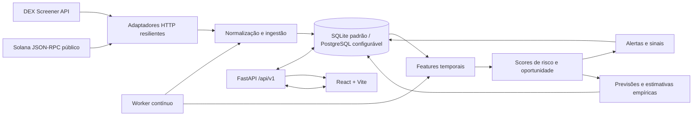
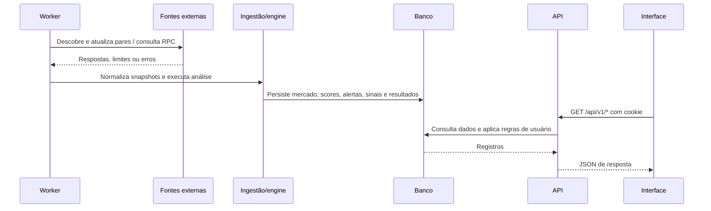

# Auditoria completa do MemeCoinAI

**Data da auditoria:** 29/10/2026  
**Pasta analisada:** `C:\Users\aliss\Downloads\Meme Coins - Projeto pessoal`  
**Escopo:** leitura do código, documentação, configuração de exemplo e testes existentes. Este relatório é novo; nenhum arquivo do produto ou arquivo de trabalho existente foi alterado nesta auditoria.

## 1. Resumo executivo

O MemeCoinAI é um MVP local, privado e de monitoramento de memecoins. Ele consulta pares de mercado do DEX Screener, coleta verificações limitadas pela RPC pública Solana, persiste observações em SQLite, calcula scores explicáveis e apresenta o resultado numa interface React. Um processo worker separado atualiza os dados. A aplicação não envia ordens e sua documentação alerta que os scores e previsões não são recomendações financeiras.

Na pasta há código de backend, frontend, migrações, contratos, documentação, testes e um script PowerShell de inicialização local. A fonte completa examinada é esta pasta. O Git local aponta para `origin` em `https://github.com/alisson-sc-account/MemeCoinAI.git`, mas este relatório não consultou nem alterou o remoto; conforme informado pelo proprietário, o conteúdo de trabalho relevante está local.

**Estado técnico observado:** a base está implementada além do MVP inicial — inclui sinais, posições simuladas, estimativas por horizonte, detector de disparo e interface — mas os documentos não foram todos atualizados para refletir esse estado. O histórico de testes no `TEST_STATUS.md` relata uma execução anterior bem-sucedida; as tentativas desta auditoria não conseguiram executar a suíte neste ambiente (detalhes na seção 13). Portanto, este relatório não certifica que o checkout atual passa nos testes.

### Conclusões principais

- O desenho geral tem separação clara entre API, worker, fontes, ingestão, motor analítico, persistência e UI.
- Os dados de mercado e as análises dependem de coleta contínua. Sem o worker, a interface pode abrir, mas seus dados envelhecem.
- Os scores e sinais são regras determinísticas definidas no código; as probabilidades ainda não são calibradas e os limiares ainda não foram validados historicamente.
- Solana é a única rede configurada por padrão. A consulta de maiores contas enfrenta HTTP 429 na RPC pública, segundo o estado do projeto.
- Estimativa de saída usa uma aproximação de produto constante sem taxas e só fica disponível para tipos de pool reconhecidos.
- A documentação `ARCHITECTURE.md` ainda diz que o frontend não foi iniciado, embora `frontend/` já esteja presente e integrado. Há outras notas antigas nos handoffs.
- O contexto do navegador fornecido ao iniciar esta auditoria continha uma URL de login com parâmetro `next` repetido. O código atual tem proteção explícita contra loop de redirecionamento, mas não foi possível reproduzir o fluxo visual durante esta auditoria.

## 2. Escopo, método e estado do repositório

Foi confirmado que o diretório de trabalho é a pasta do projeto. O comando `git` não estava no `PATH` desta sessão; os comandos de inspeção foram executados usando `C:\Program Files\Git\cmd\git.exe`.

Estado inicial observado:

- Branch: `main`, acompanhando `origin/main`.
- `origin` fetch/push: `https://github.com/alisson-sc-account/MemeCoinAI.git`.
- Árvore de trabalho já continha arquivos modificados e não rastreados antes da criação deste relatório — incluindo módulos backend novos, migrações, testes, frontend, script de execução e documentos. Esses arquivos foram preservados.
- Nenhum commit ou push foi feito.
- Nenhum segredo, valor de senha ou conteúdo de `.env` foi incluído aqui. Foi lido somente o `.env.example` e suas chaves/configurações não secretas.

A leitura cobriu `README.md`, `PROJECT_STATE.md`, `HANDOFF.md`, `TEST_STATUS.md`, `ARCHITECTURE.md`, `API_CONTRACT.md`, `backend/app`, migrações, inventário de testes, `frontend/src`, `frontend/package.json`, `backend/pyproject.toml` e `run-local.ps1`. Os dados locais do banco e as credenciais locais não foram inspecionados.

## 3. Estrutura encontrada

| Caminho | Função observada |
|---|---|
| `backend/app/api/` | Rotas HTTP da API FastAPI: autenticação, sistema, tokens, alertas, previsões, sinais e posições. |
| `backend/app/engine/` | Features, scores, alertas, previsões, sinais, rotulagem de resultados, impacto de saída e detecção de bursts. |
| `backend/app/ingest/` | Normalização e ingestão, descoberta, acompanhamento e limpeza de tokens inativos. |
| `backend/app/sources/` | Adaptadores HTTP resilientes para DEX Screener e RPC Solana. |
| `backend/app/models.py`, `schemas.py`, `db.py` | Modelos SQLAlchemy, contratos Pydantic e ciclo de conexão/sessão do banco. |
| `backend/app/worker.py` | Laço contínuo de jobs de descoberta, refresh, verificações e avaliação. |
| `backend/app/cli.py` | Operações pontuais de migração, seed, track, descoberta, refresh, verificações, avaliação, retenção e OpenAPI. |
| `backend/migrations/versions/` | Migrações `0001` inicial, `0002` sinais/posições/resultados e `0003` configurações de saldo. |
| `backend/tests/` | Testes unitários e de fluxo, frontend servido, sinais e descoberta/burst. |
| `frontend/src/App.tsx` | Rotas de interface, autenticação protegida e páginas principais. |
| `frontend/src/api/` | Cliente HTTP, tipos gerados/manualizados e modelos da API. |
| `frontend/src/features/` | UI de sinais, posição, saldo simulado e som. |
| `frontend/src/components/` | Gráfico e testes dos fluxos/componentes. |
| `docs/openapi.json` | Especificação OpenAPI registrada no repositório. |
| `run-local.ps1` | Preparação e inicialização local de API/interface e worker em Windows. |
| `README.md`, `*_SPEC.md`, `*_CONTRACT.md`, `PROJECT_STATE.md`, `TASKS.md` | Instalação, produto, decisões, contrato, situação e continuidade. |

## 4. Arquitetura e fluxo dos dados



O backend e o worker são processos separados, mas usam a mesma base. A API inclui as rotas sob `/api/v1`; se existir `frontend/dist`, serve o SPA na mesma origem. Em desenvolvimento, Vite encaminha `/api` para a API local. O cliente da UI envia cookies de sessão nas requisições.



### Ciclo do worker

O `worker.py` coordena quatro jobs definidos pela configuração: descoberta/prune, refresh/análise, verificações de risco e avaliação/rotulagem. O padrão documentado é refresh e verificações a cada 30 segundos, descoberta a cada 300 segundos e avaliação a cada 120 segundos. Cada job abre sessão própria e registra falhas sem derrubar todo o processo. A documentação exige apenas um worker por banco; não há lock distribuído.

## 5. Interface e navegação

`frontend/src/App.tsx` define as páginas e a proteção por sessão. A UI usa React 18, TypeScript, React Router, TanStack Query, Vite, Lucide e `lightweight-charts`.

| Rota | Conteúdo observado |
|---|---|
| `/login` | Formulário de autenticação; após login pode voltar à rota `next` após validação local. |
| `/` | Visão geral, oportunidades/riscos, estado das fontes e alertas recentes; inclui sinais ativos. |
| `/tokens` | Explorer/lista filtrável, pesquisa e navegação para detalhes. |
| `/tokens/:chainId/:address` | Identidade, frescor, sinal, posição/sugestão, dados de mercado, gráfico, alertas e detalhes técnicos. |
| `/alerts` | Lista de alertas e ações de status. |
| `/alerts/:id` | Detalhe do alerta. |
| `/predictions` | Previsões, estado de avaliação e métricas. |
| `/system` | Saúde, status de fontes e execuções recentes do coletor. |
| `/account` | Configuração de saldo simulado, preferência de som, troca de senha e logout. |

A UI atualiza consultas de mercado/sinais em intervalos de 30 segundos conforme o código e a documentação do projeto; a tela de sistema indica atualização manual. Há menu responsivo, estados de carregamento/erro/vazio, badges de frescor e risk, cópia de endereço, gráficos por período, preferências de som via Web Audio e watcher para sinais novos. O gráfico apresenta snapshots coletados pelo sistema, não candles oficiais.

O código atual em `App.tsx` instala um único tratador de 401 que evita navegar para login se já estiver em `/login`; o guard de login também evita que `next` retorne à própria tela de login. Isso trata o bug de loop registrado em `HANDOFF.md`. A URL ambiente repetitiva é um alerta de contexto, mas a correção documentada não foi validada novamente em navegador nesta auditoria.

## 6. Backend, fontes e coleta

### Fontes

- **DEX Screener:** origem de pares, preço, liquidez, volumes/transações em janelas disponíveis, variação, FDV/capitalização, idade e links sociais declarados. O repositório registra descoberta por perfis, boosts e termos de pesquisa rotativos. A fonte não representa todo o mercado e, conforme a documentação, não fornece holders, compradores únicos nem histórico OHLC completo.
- **Solana RPC pública:** verificações de autoridade de mint/freeze, programa/extensões Token-2022 e maiores contas. O projeto relata HTTP 429 recorrente em `getTokenLargestAccounts`; por isso, concentração de holders frequentemente não está disponível.
- **Resiliência HTTP:** cliente compartilhado tem timeout, limite de ritmo, até três tentativas para erros transitórios/429/5xx e backoff limitado. Respostas 4xx não transitórias não são repetidas.

### Ingestão

`ingest/normalize.py` normaliza endereços e números ausentes/ inválidos; `ingest/service.py` faz descoberta, deduplicação/upsert de pares e armazenamento de snapshots. A configuração atual permite até 600 tokens e oito termos de busca por ciclo, mas o universo real continua restrito ao que as fontes públicas descobrem. `prune_inactive` deixa de acompanhar ativos sem atividade segundo critérios configurados, preservando watchlist/posições segundo o handoff.

### Motor de risco e oportunidade

`features.py` deriva métricas de snapshots e janelas temporais; a intenção é usar apenas dados disponíveis no instante analisado. `scoring.py` soma fatores nomeados e explicáveis e limita scores entre 0 e 100. Risco inclui, entre outros, pressão vendedora, poucas transações grandes, preço em queda, idade do par, autoridade ativa e extensões perigosas, além de penalidades por verificações ausentes. Oportunidade usa aceleração de volume/transações, proporção de compras, momentum e liquidez, com penalidade de risco e tetos quando liquidez/dados são insuficientes.

Os nomes de regra visíveis no código incluem `risk-1`/`opp-1` em documentação, `sig-1`, `advice-1`, `burst-1` e `slip-1`. Pesos e limiares são regras explícitas; não são aprendizado validado nem garantia de retorno. A própria documentação afirma que pesos/limiares não foram calibrados historicamente.

### Sinais, estimativas e posições

- Sinais `buy`, `sell`, `avoid` ou `hold` e força (moderada/forte) são produzidos por regras sobre frescor, risco, oportunidade, liquidez e fatores técnicos.
- Estimativas de 15 min, 1 h e 6 h usam distribuições de resultados passados disponíveis antes do instante avaliado, agrupadas por buckets de scores; se não há amostra mínima, o sistema declara insuficiência.
- O detector de burst cria alerta específico com base no histórico observado do padrão; não indica confirmação futura.
- Posições guardam quantidade e preço de entrada para acompanhamento, não integram carteira on-chain nem enviam ordens.
- `allocation` e `advice` calculam sugestões a partir do saldo de simulação e do limite por operação configurado pelo usuário. Esses números são sugestões exibidas na UI, não execução transacional.

### Previsões

`predict.py` cria previsões heurísticas para alvos de alta de 20% ou queda de 30% em seis horas. O código registra `calibrated=False`; coeficientes são a priori. A avaliação usa snapshots do próprio coletor, pode não capturar picos entre coletas e descarta cobertura insuficiente como “inavaliável”. Métricas incluem Brier, taxa observada, limiares, bins de calibração e buckets de liquidez. Elas não devem ser interpretadas como probabilidade de lucro ou previsão calibrada.

### Estimativa de saída

`slippage.py` reconhece alguns pools de produto constante e aplica modelo `x*y=k`. Não inclui taxa do pool, gas/prioridade, movimento de preço durante execução nem dinâmica de liquidez concentrada. Para CLMM/DLMM/Whirlpool/bonding curves ou pools desconhecidos, é declarada indisponível. É uma aproximação de cenários, não cotação de execução.

## 7. Banco e modelos de dados

O banco padrão é SQLite local sob `backend/data`; PostgreSQL é configurável por URL, mas não consta como validado nesta máquina segundo `PROJECT_STATE.md`. Migrações são Alembic e incluem:

1. `0001_initial_schema.py`: estrutura base de usuários/sessões, tokens/pares/snapshots, verificações, análises, alertas, previsões e execuções do coletor.
2. `0002_signals_positions_outcomes.py`: persistência para sinais, posições e resultados/avaliações empíricas.
3. `0003_user_balance_settings.py`: saldo, moeda e limite percentual simulados por usuário.

Configuração documentada mantém payload bruto por três dias e retém snapshots por período maior; a rotina de retenção tem modo de relatório e modo explícito `--apply`. A limpeza de retenção não foi executada nesta auditoria. Migrações locais anteriores mencionadas pelos handoffs não foram reaplicadas aqui.

## 8. API HTTP

Base da API: `/api/v1`. A API também publica OpenAPI e Swagger em `/api/v1/openapi.json` e `/api/v1/docs`. Rotas identificadas no código:

| Área | Operações principais |
|---|---|
| Auth | `POST /auth/login`, `POST /auth/logout`, `GET /auth/me`, `GET/PUT /auth/settings`, `POST /auth/change-password`. |
| Sistema | `GET /health`, `GET /system/sources`, `GET /meta`, `GET /dashboard/summary`. |
| Tokens | `GET /tokens`, `POST /tokens/track`, `DELETE /tokens/{chain}/{address}/track`, `GET /tokens/{chain}/{address}`, `GET .../history`, `GET .../exit-estimate`. |
| Alertas | `GET /alerts`, `GET /alerts/{id}`, `PATCH /alerts/{id}`. |
| Previsões | `GET /predictions`, `GET /predictions/metrics`. |
| Sinais e posições | `GET /signals`, `GET /signals/performance`, `GET /signals/{id}`, `GET /positions`, `PUT/DELETE /positions/{chain}/{address}`. |

O contrato documenta respostas paginadas, erros estruturados e datas UTC. Login e health são exceções públicas; o restante usa sessão em cookie `httpOnly`, `SameSite=Lax`. O token de sessão é opaco, persistido como hash. Senhas usam Argon2id. O limitador de tentativas de login é em memória, portanto não é compartilhado entre processos nem reinicializações.

## 9. Execução local

No Windows, `README.md` recomenda:

```powershell
cd "C:\Users\aliss\Downloads\Meme Coins - Projeto pessoal"
powershell -ExecutionPolicy Bypass -File .\run-local.ps1
```

O script pode criar `.venv`, instalar o pacote backend se o ambiente não existir, copiar `.env.example` para `.env` se necessário, aplicar migrações, semear contas iniciais, instalar dependências NPM se necessário, gerar `frontend/dist`, abrir worker em outra janela e servir a API/UI em `http://127.0.0.1:8000`. Ele suporta `-NoStart` e `-Port`. A primeira execução precisa de `SEED_INITIAL_PASSWORD` forte definido localmente. Esses passos são descritos aqui; não foram executados nesta auditoria.

Para desenvolvimento de frontend, README orienta rodar a API e `npm run dev` em `frontend/` (Vite normalmente em `http://localhost:5173`). Para coleta contínua, `python -m app.worker` deve permanecer ativo. Antes de expor o sistema à rede, revisar as recomendações de senha e cookie seguro em `README.md` e `backend/app/config.py`.

## 10. Segurança e privacidade

**Pontos positivos observados:** sessões cookie `httpOnly`, hash de senha Argon2id, hash do token de sessão armazenado, tentativa de reduzir enumeração temporal de usuários, erros estruturados, `.env` ignorado e ausência de segredo de API obrigatório nas fontes públicas.

**Atenções registradas no próprio projeto:**

- O exemplo define `SESSION_COOKIE_SECURE=false` para desenvolvimento local; em HTTPS de produção, a própria configuração recomenda ativar `true`.
- `SEED_INITIAL_PASSWORD` no exemplo é placeholder fraco. Não deve ser usado como senha real nem enviado ao GitHub. A documentação diz que as senhas iniciais atuais são apenas para desenvolvimento e devem ser trocadas antes de qualquer exposição.
- O limitador de login em memória não oferece controle compartilhado em múltiplos processos.
- Ainda não há configuração/implantação pública auditada; CORS, HTTPS, proxy, backups, acesso à base, rotação de credenciais e proteção operacional precisam de decisão antes de hospedar.
- Saldo simulado e posição são dados informados pelo usuário e locais à aplicação, não carteira conectada. Som usa Web Audio no navegador.

Esta auditoria não leu `backend/.env`, não enumerou credenciais locais e não transmite arquivos para o remoto.

## 11. Qualidade, testes e evidências

O repositório contém testes backend (`test_units.py`, `test_flow.py`, `test_signals.py`, `test_burst_discovery.py`, `test_frontend_serving.py`) e frontend (cliente, formato, fluxos, badges, redirecionamento e sinais). O `TEST_STATUS.md` registra para a sessão de 28/10: **78 testes backend e 20 frontend aprovados**, typecheck/lint/build OK; Playwright E2E não executado por falta do Chromium. Esse resultado é histórico/documentado, não execução realizada nesta auditoria.

### Tentativas nesta auditoria

| Comando/checagem | Resultado atual |
|---|---|
| `git status --short --branch` e `git remote -v` (Git pelo caminho absoluto) | Concluídos; árvore já estava suja com arquivos de trabalho locais e remoto configurado. |
| `backend/.venv/Scripts/python.exe -m pytest -p no:cacheprovider` | Não validou a suíte: ambiente virtual reportou que não conseguiu localizar a instalação real `Python314`; pytest emitiu erros de coleta. Interrompido ao identificar a falha ambiental, sem modificar o ambiente. |
| `npm test -- --reporter=dot` | Não validou a suíte: Vitest encontrou erros não tratados `EPERM` ao resolver `frontend/node_modules/vitest/dist/spy.js`; zero arquivos/testes coletados nessa execução. |
| Build, lint, typecheck, E2E, navegador e teste contra fontes externas | Não executados nesta auditoria. |

Os resultados acima são limites do ambiente desta sessão e não prova de que os testes do código falhariam num ambiente funcional. Também não autorizam afirmar que passam no checkout atual. Nenhuma dependência foi instalada.

## 12. Divergências e pendências identificadas

1. **Documentação de arquitetura antiga:** `ARCHITECTURE.md` declara “Frontend ainda não iniciado”, embora exista `frontend/src`, integração SPA em `backend/app/main.py` e testes de frontend. Atualizar o estado e o diagrama do documento numa tarefa autorizada.
2. **Handoffs com instruções obsoletas:** o texto da sessão 3 ainda fala em “API antiga” e necessidade de reiniciar naquele momento; é um registro histórico, mas pode confundir se lido sem a data/contexto. A sessão 4 e `PROJECT_STATE.md` já descrevem features mais recentes.
3. **Status de Git inconsistente entre documentação e estado observado:** arquivos modificados e não rastreados existem nesta pasta. Os documentos têm observações históricas de “não commitado”/commit inicial autorizado que não devem ser interpretadas como o status exato atual. Foi preservado todo o estado presente.
4. **Prova recente de testes bloqueada:** restaurar/corrigir o caminho Python do `.venv` e permitir acesso do runner Node a `node_modules`, então repetir suites, typecheck, lint e build. Não reinstalar nem recriar sem autorização do proprietário.
5. **E2E:** Playwright consta configurado, mas o Chromium não estava instalado na execução histórica relatada. A cobertura manual documentada não substitui E2E automatizado.
6. **Validade analítica:** acumular amostras reais ao longo de períodos mais longos, medir calibração e Brier por regime/liquidez, comparar baseline e registrar limitações antes de usar métricas como orientação. Não ajustar limites sem dados e versionamento de regra.
7. **Fontes e rede:** resolver decisão de RPC Solana dedicado (se apropriado e sem custo indesejado) ou manter concentração “indisponível”; avaliar outras redes apenas se autorizadas e implementadas/testadas.
8. **Operação:** worker por horas, PostgreSQL, carga, retenção aplicada, deploy, backup/restauração, monitoramento e resposta a falhas não foram comprovados nesta auditoria.
9. **Navegador fornecido:** URL ambiente continha repetição profunda de `next=/login...`; código registra correção para esse loop, mas falta confirmar em sessão limpa com testes executáveis.

## 13. Melhorias priorizadas

| Prioridade | Próxima ação recomendada | Motivo |
|---|---|---|
| P0 | Tornar o ambiente de execução dos testes funcional sem remover/recriar estado local; repetir testes e registrar saída atual. | Hoje não há confirmação independente da suíte deste checkout. |
| P0 | Revisar documentação contraditória e consolidar um status atual: frontend integrado, novos endpoints/migrações, limites e comandos. | Evita instruções falsas para continuidade. |
| P1 | Reproduzir o login com cookies/sessões expiradas e `next` em navegador limpo e adicionar E2E quando Chromium estiver disponível. | Contexto do navegador mostrou URL recursiva; código atual contém mitigação, mas a regressão precisa ser verificada. |
| P1 | Trocar credenciais iniciais, ativar cookie Secure sob HTTPS e definir um plano de deploy/backup antes de exposição externa. | Reduz risco de acesso e perda de dados em operação pública. |
| P1 | Coletar histórico suficiente e avaliar sinais/previsões fora da amostra, reportando tamanho de amostra, deriva e comparativo de baseline. | Scores e coeficientes atuais não são calibrados historicamente. |
| P2 | Medir limitações de descoberta, limites de requests e cobertura RPC com execução prolongada; documentar degradados. | Fontes gratuitas têm lacunas e limites observados. |
| P2 | Testar restore do SQLite e retenção em cópia isolada, documentando rotina operacional. | Banco e snapshots são o principal estado persistente local. |
| P3 | Reavaliar PostgreSQL/escala só quando necessidade e custo estiverem claros. | O estado atual foi desenhado para um worker e uso pequeno, sem PostgreSQL verificado. |

## 14. Tutorial de leitura do código

Para seguir uma análise, use esta trilha:

1. `backend/app/worker.py` — veja como os jobs são agendados.
2. `backend/app/ingest/service.py` — siga descoberta, refresh e persistência de dados externos.
3. `backend/app/ingest/normalize.py` — confira como respostas externas viram pares normalizados.
4. `backend/app/engine/features.py` — entenda como snapshots formam métricas temporais.
5. `backend/app/engine/scoring.py` — examine os fatores, pesos, limites e cobertura de dados.
6. `backend/app/engine/pipeline.py` — veja como a análise é persistida e conectada a alertas, sinais e previsões.
7. `backend/app/api/` + `backend/app/schemas.py` — localize endpoints e formato das respostas.
8. `frontend/src/api/client.ts` — veja chamadas da interface.
9. `frontend/src/App.tsx` e `frontend/src/features/signals.tsx` — percorra rotas e fluxos de usuário.
10. `backend/tests/` e `frontend/src/**/*.test.tsx` — use os testes como exemplos de regras; execução atual aguarda correção ambiental.

## 15. Glossário

| Termo | Significado neste projeto |
|---|---|
| Snapshot | Observação recebida da fonte em determinado instante; não é candle. |
| Par/pool | Mercado de negociação de um token contra outro ativo. |
| Frescor | Idade da observação, classificada como `fresh`, `delayed`, `stale` ou `no_data`. |
| Score de risco | Pontuação heurística de fatores adversos e lacunas de verificação, não probabilidade. |
| Score de oportunidade | Pontuação heurística de sinais de atividade/liquidez, sujeita a penalidades e tetos. |
| Sinal | Ação explicável `buy`, `sell`, `avoid` ou `hold`; não executa transação. |
| Resultado/outcome | Retorno observado nos snapshots após um horizonte; pode ser inavaliável se faltar cobertura. |
| Brier score | Erro quadrático médio de probabilidades para resultados binários; exige amostra suficiente e não calibra o modelo sozinho. |
| `x*y=k` | Modelo de produto constante para aproximar o impacto de swap em alguns pools. |
| Worker | Processo de longa duração que coleta, analisa e avalia; distinto do servidor HTTP. |
| `stale` | Dado além do limite de atraso documentado, que não deve ser apresentado como atual. |

## 16. Fontes internas consultadas

- `README.md` — instalação, execução, testes e segurança local.
- `PROJECT_STATE.md` — capacidades, limites e decisões de operação registradas.
- `HANDOFF.md` e `TEST_STATUS.md` — mudanças e resultados de sessões anteriores.
- `ARCHITECTURE.md` — visão arquitetural (com trecho desatualizado sobre frontend).
- `API_CONTRACT.md`, `docs/openapi.json`, `backend/app/schemas.py` — contrato e tipos.
- `backend/app/main.py`, `worker.py`, `config.py`, `models.py`, `security.py`.
- `backend/app/api/`, `engine/`, `ingest/`, `sources/` — rotas, análise e coleta.
- Migrações `0001`–`0003`, `backend/tests/`, `frontend/src/` e `frontend/package.json`.
- `run-local.ps1` e `backend/.env.example` (somente configurações de exemplo; nenhum `.env` local foi lido).

---

Este relatório documenta o estado observado na pasta local na data indicada. Não altera o comportamento do MemeCoinAI nem substitui validação de segurança, execução prolongada, calibração estatística ou verificação de deploy.
